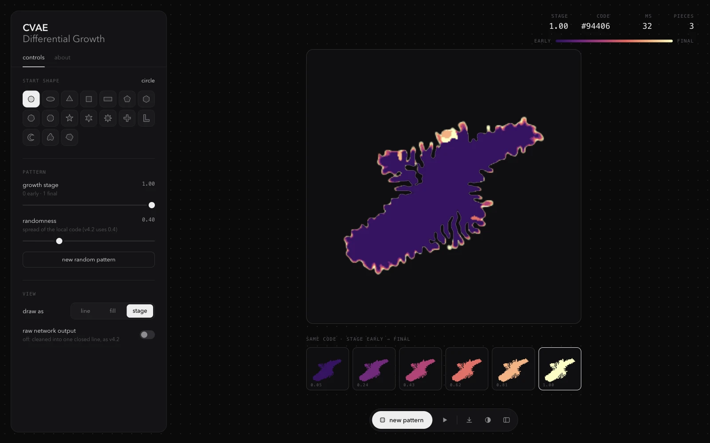
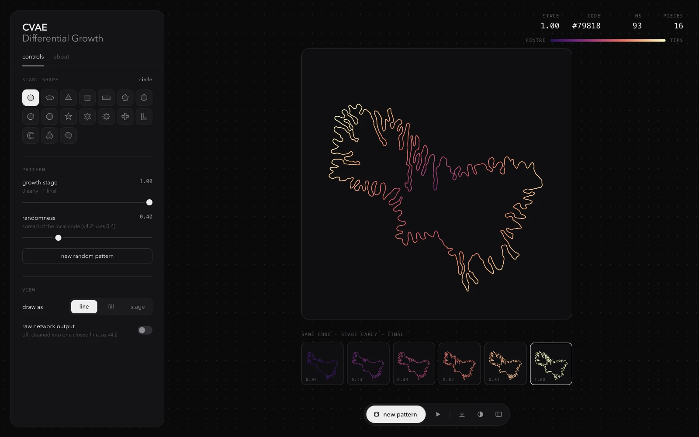

**Jay Anupoju's CVAE v4.2, running entirely in the browser.** Pick a start
shape, set the growth stage and the randomness, and the network draws a new
differential-growth pattern; the strip below keeps the code and plays it from
early to final. No server: the trained weights are exported to ONNX and run
on WebGPU, falling back to WASM.

[Live site ↗](https://alichaaraoui.github.io/cvae-growth/)

