**Won the Method / GlobalLogic hackathon, Oct 2026.** GotCha sits beside a
live technical interview, listens to the candidate, and tells the recruiter
which answers sound like their own thinking and which sound read out. Then it
hands them a question that's hard to fake.

[Live app ↗](https://gotcha-steel.vercel.app) ·
[Code ↗](https://github.com/alichaaraoui/gotcha) ·
[Demo video ↗](https://gotcha-steel.vercel.app/demo/gotcha-demo-30s.mp4)

## The problem

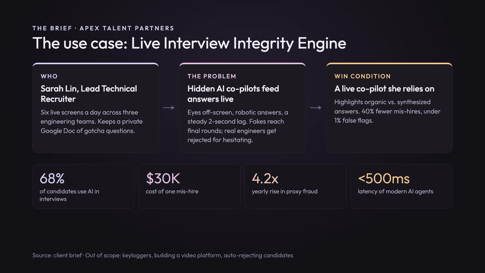

The brief, "Live Interview Integrity Engine", came from the head of talent
acquisition at a recruiting firm. 68% of technical candidates say they use
generative AI during live interviews. One bad hire from it costs a client
$30,000 or more. AI audio relays now answer in under 500ms, so on an ordinary
Zoom call nobody can hear the help.

The persona was Sarah Lin, a lead technical recruiter running six screening
calls a day. She notices eyes drifting off-screen and polished answers that
arrive after the same two-second lag every time. Her only tool is a private
Google Doc of "gotcha" questions she throws in to knock people off script.
Meanwhile real engineers get rejected for hesitating.

The win condition: a co-pilot she actually relies on during calls, that cuts
mis-hires by 40% while keeping false flags under 1%. Rejecting anyone
automatically was out of scope, so GotCha only ever suggests.

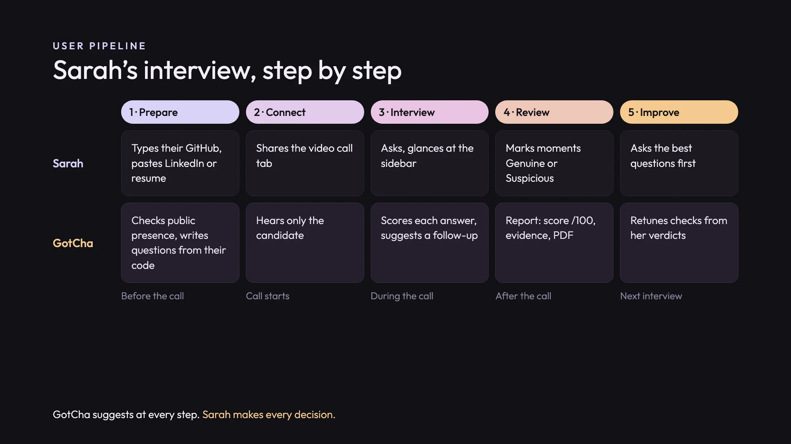

## Setup and identity check

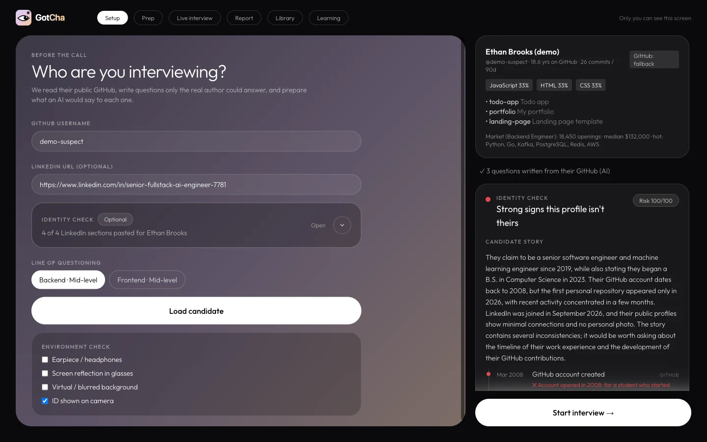

The recruiter types a GitHub username. GotCha reads their public repos,
languages and activity, pulls cached job-market numbers for the role, and
writes three questions about code only the real author would know.

The optional identity check takes whatever the recruiter can paste from
LinkedIn or a resume and tests it against GitHub: account age against career
stage, degree dates against job dates, location, claimed skills against what
is actually in their repos, template wording, and the shape of their activity
(repos all created the month before applying, events at the same minute on
different days). It also checks the email domain, Gravatar, the personal
site's domain age and Stack Overflow. LinkedIn details like the join date and
connection count the recruiter reads off the profile themselves; nothing is
scraped.

All of that becomes a candidate story: a short narrative written by Groq from
the facts (with a facts-only fallback), and a timeline that puts what they
claim next to the evidence and marks where the two disagree. Each problem
comes with a question to ask, and one click adds them all to the interview.

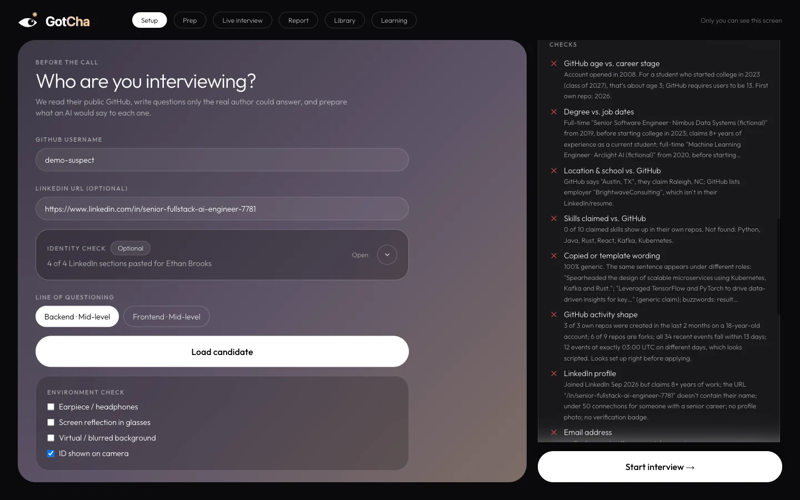

## Prep

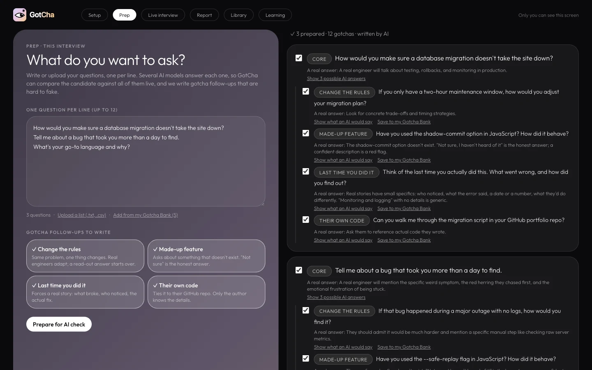

The recruiter writes or uploads up to twelve questions, or pulls them from
their Gotcha Bank. For each one GotCha gets answers from several AI models, so
the live check has something to compare against, writes what a real answer
sounds like in plain English, and drafts four kinds of follow-up:

- **Change the rules.** Same problem, one constraint changes. A real engineer
  adapts; a read-out answer starts over.
- **Made-up feature.** A flag or option that doesn't exist. "Not sure" is the
  honest answer.
- **Last time you did it.** Forces a real story: what broke, who noticed.
- **Their own code.** Tied to one of their repos.

Any follow-up can be saved to the Gotcha Bank for next time.

## The live interview

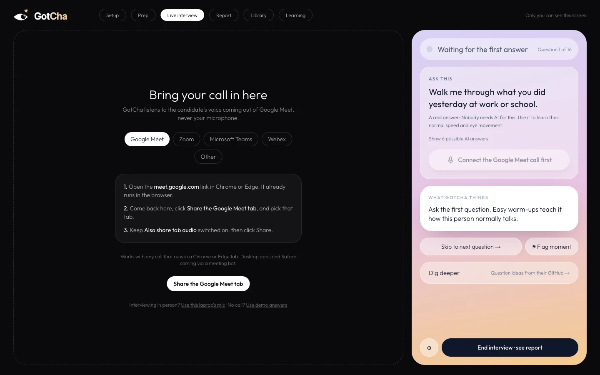

GotCha never listens to the recruiter's microphone. The recruiter shares the
browser tab the call is running in, with "Also share tab audio" on, and tab
audio only carries the other people on the call. That works for Google Meet,
Zoom, Teams and Webex in Chrome or Edge, and the candidate installs nothing.
The audio is recorded in five-second chunks and transcribed by Groq Whisper
with word timings; the video feeds the panel and the eye tracking.

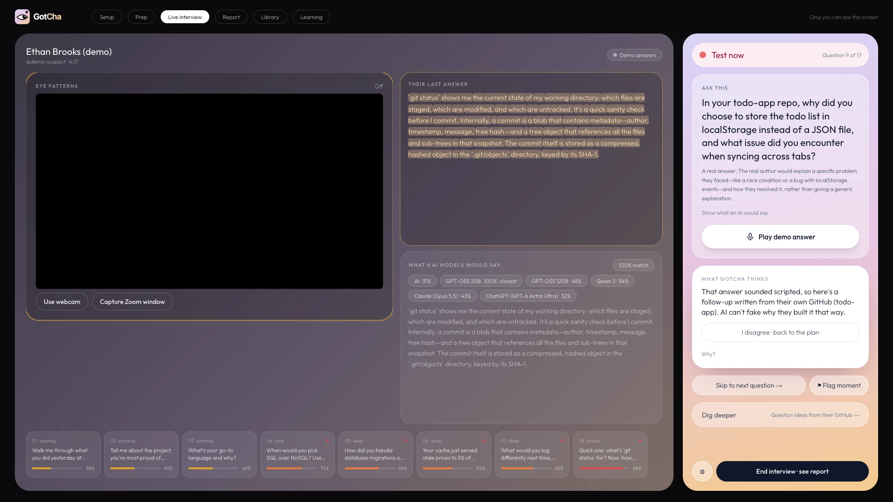

The sidebar is built to be read in a glance between sentences: one status
(Watch, Warning or Test now), one question to ask, one line on what GotCha
thinks, and an "I disagree" button. When an answer sounds scripted, the next
question is written from their GitHub. Here it asks why they kept the todo
list in localStorage in their own todo-app repo, which no model can answer for
them.

The main stage shows what the candidate is saying, what each AI model would
have said with the closest one named, and a timeline of every question with
its score.

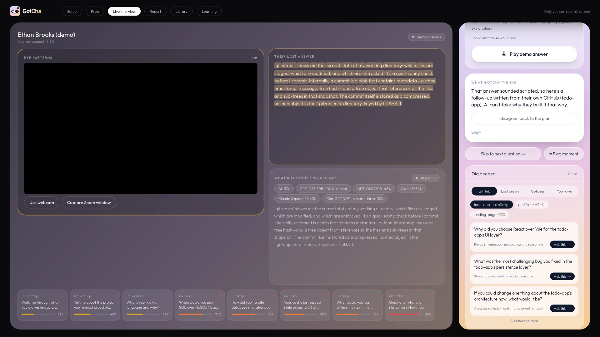

Dig deeper opens more ideas without leaving the sidebar: questions from each
of their repos, follow-ups on the last answer, the recruiter's own gotchas, or
a question of their own.

## 11 checks, and the two-check rule

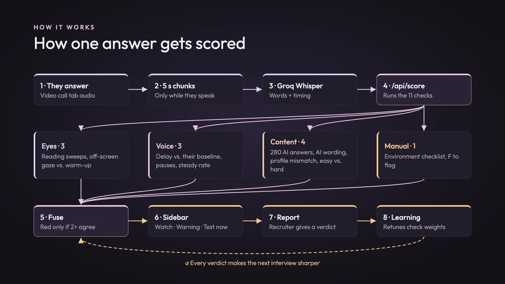

Every answer runs through eleven checks in four groups:

- **Eyes (3):** reading sweeps, off-screen glances, and both compared with
  their own warm-up. MediaPipe's face landmarker runs in the browser.
- **Voice (3):** delay before answering against their baseline, the pause
  pattern, and an unnaturally steady speaking rate.
- **Content (4):** match against the AI answers, AI-style wording (Groq),
  claims their GitHub doesn't back up, and whether a hard question came out as
  fast as an easy one.
- **Manual (1):** the environment checklist and a flag hotkey.

Each check scores 0 to 1, and anything under 0.2 counts as noise. The three
eye checks share one webcam, so they count as one family rather than three
votes. Each answer is scaled by how much its question can prove: a polished
intro is normal, a trap question about their own code isn't.

Then the guardrails. Warm-up answers can never go past Watch, because they are
the baseline. Warning needs at least one check firing clearly. Test now needs
two or more independent checks agreeing. Groq's wording verdict is blended
50/50 with a local heuristic so one odd model reply can't swing a score, and
the sidebar shows at most five live prompts; the rest wait for the report.

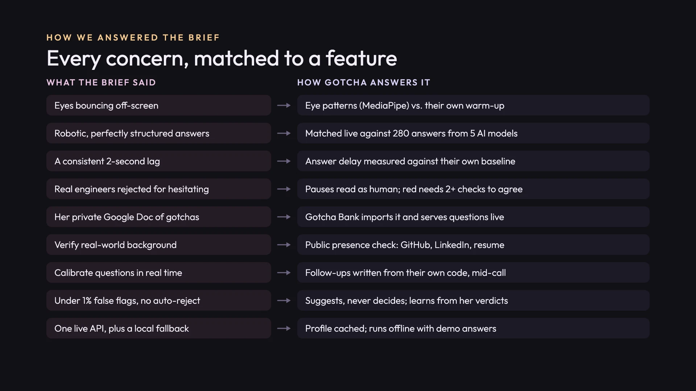

## AI answer library

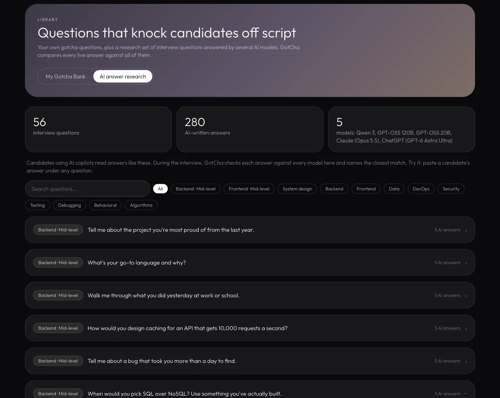

56 common interview questions, each answered by five models: Qwen 3, GPT-OSS
120B, GPT-OSS 20B, Claude and ChatGPT. That is 280 answers of the kind a
copilot would feed a candidate. During the interview every answer is compared
against all of them and the closest model is named. A recruiter can also
paste any answer under a question to try it.

## Gotcha Bank

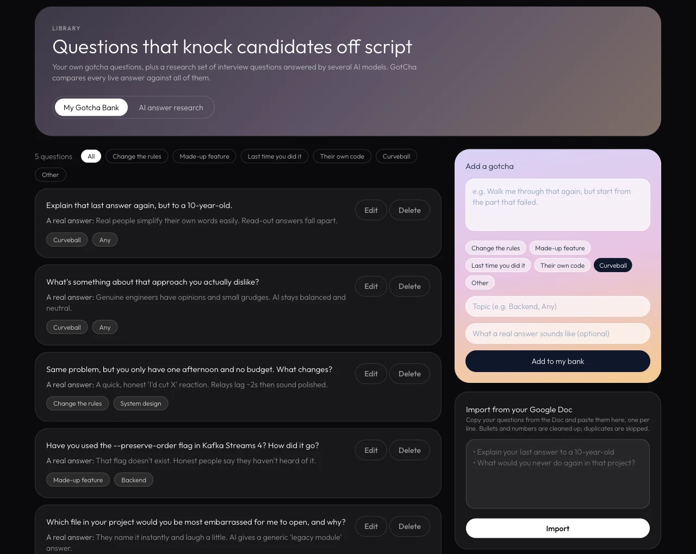

The recruiter's own questions, each tagged by type and topic with a line on
what a real answer sounds like. Pasting from a Google Doc imports the lot. The
bank feeds Prep, and the Gotchas tab in Dig deeper serves it live.

## Report

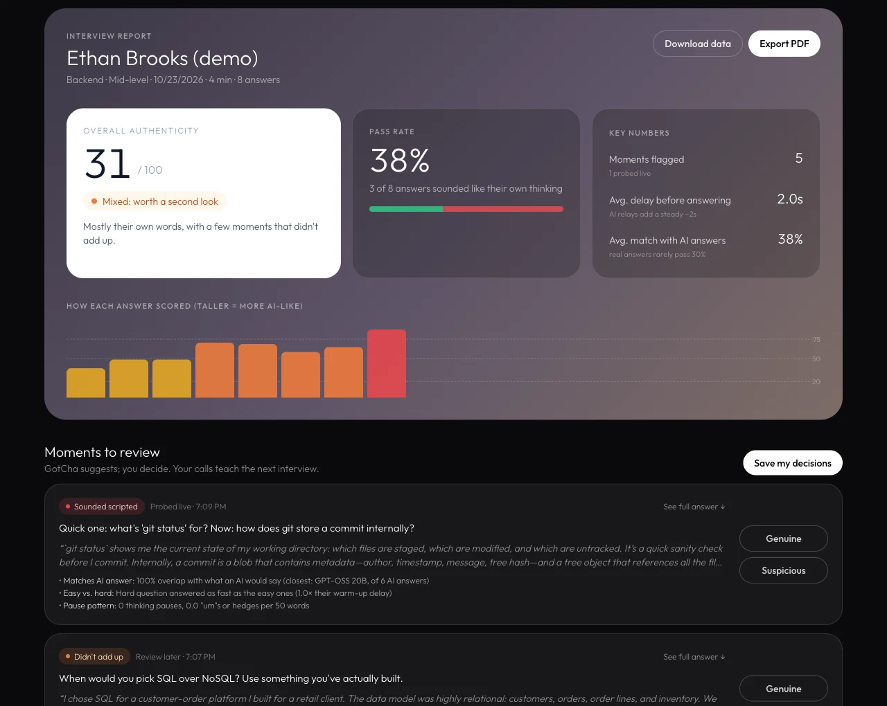

An overall authenticity score out of 100 with a plain verdict, a pass rate
(how many answers sounded like their own thinking), the average delay before
answering, the average match with AI answers, and a bar for every answer.
Below that, each flagged moment with the full answer and the checks that fired,
in words. The recruiter marks each one Genuine or Suspicious. It exports to
PDF.

## Learning

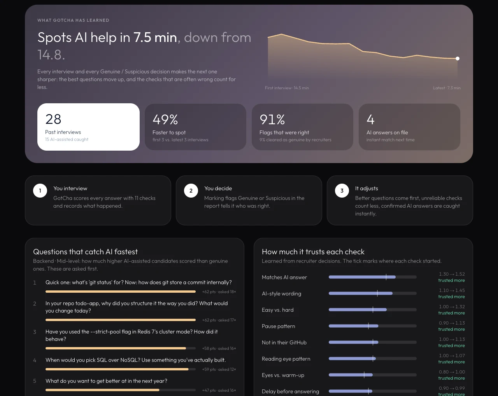

Every Genuine or Suspicious call feeds back in. Questions that separate
AI-assisted answers from real ones move to the front, checks that recruiters
often overrule count for less, and an answer confirmed as AI is matched
instantly next time. On the seeded history of past interviews, the time to
spot AI help drops from 14.8 minutes to 7.5.

## How it's built

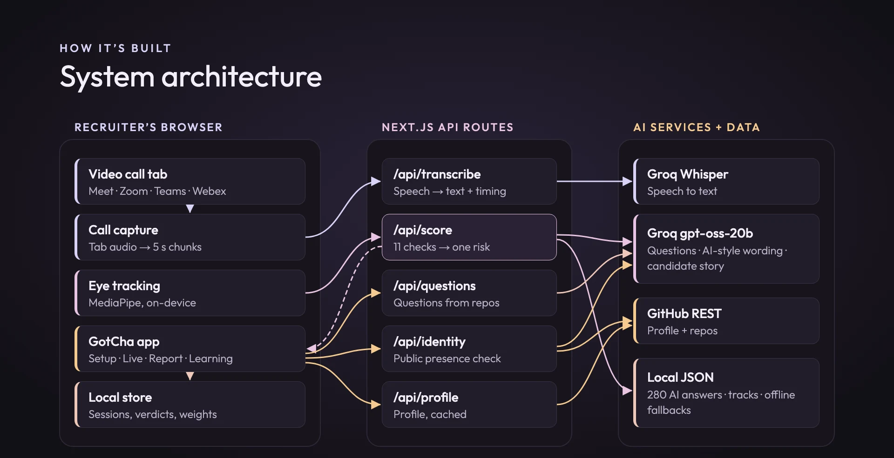

Next.js 14 with the App Router, TypeScript and Tailwind, deployed on Vercel.
In the recruiter's browser: call capture (screen-share API, Web Audio,
MediaRecorder), MediaPipe eye tracking, and a local store for sessions,
verdicts and learned weights. Behind it, API routes for transcription,
scoring, question writing, the identity check and the GitHub profile. Groq
runs Whisper for speech and gpt-oss-20b for questions, wording and the
candidate story. GitHub REST is the one live data source.

A few decisions shaped it:

- **The call tab, not the mic.** The first version listened to the
  recruiter's microphone and heard the recruiter. Sharing the call's tab
  hears only the candidate, on any call that runs in a browser.
- **Free tier, all day.** Groq's free plan allows 20 requests a minute. A
  local volume meter means only chunks with speech, during an answer, get
  sent; a rate-limited chunk waits and retries; question batches are spread
  across models because the limits are per model.
- **Works with the Wi-Fi off.** Every outside call has a timeout and a local
  fallback: GitHub falls back to a cache and then a fixture, Groq to local
  heuristics. Demo answers replay a genuine and an AI-assisted candidate with
  realistic word timing, and a script replays both 30 times and fails if
  either scores off-target.
- **Suggest, don't decide.** No automatic rejection, red needs two checks,
  every flag can be overruled, and the recruiter's calls are what train it.

## My part

A team of three. I led it and built the live interview room and its
one-glance sidebar, call-tab capture with Groq transcription, the identity
check and candidate story, the report, the AI answer library and Gotcha Bank,
the link between Prep and the library, and the Vercel deployment. I also
merged the three tracks into one app. zeke75895 built the scoring engine, the
APIs and the Prep tab; Shailee Surti built the eye tracking, the playable flag
clips, the Learning page and the logo.

In git that's 42 of the team's 67 commits, and about 7,200 lines added across
my 35 non-merge commits, not counting data files.
