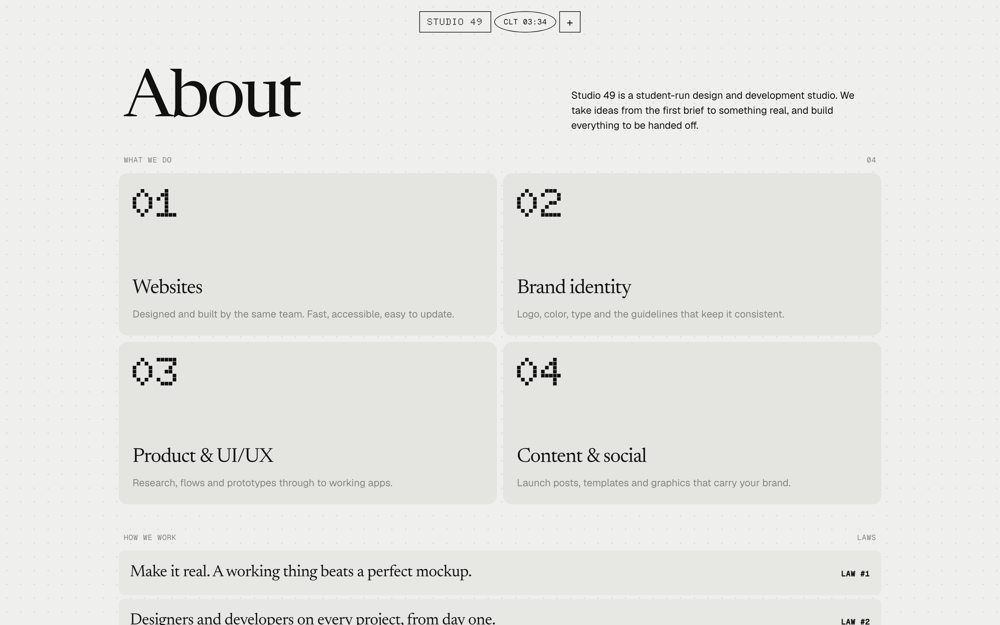
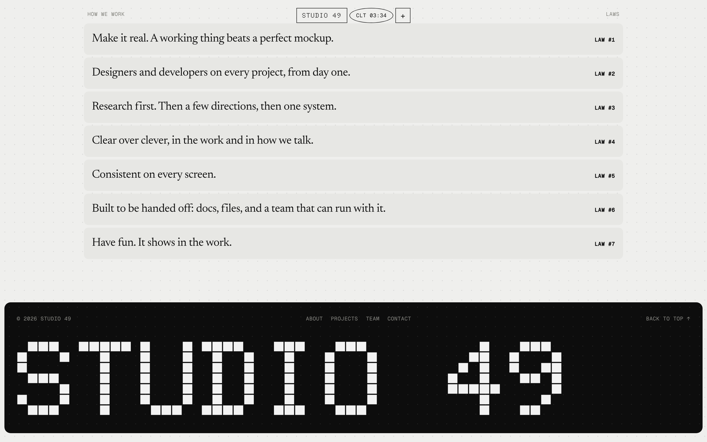
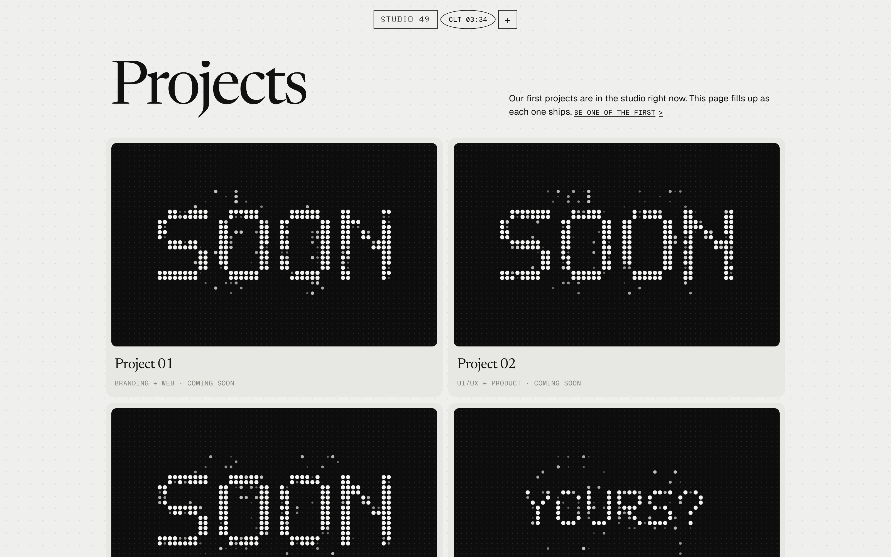
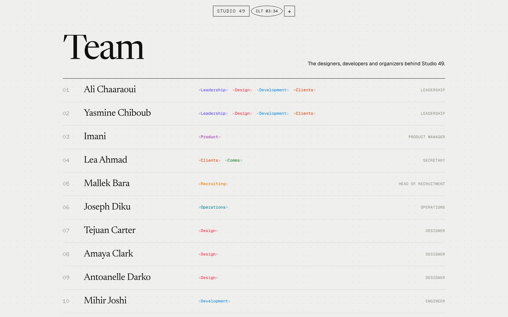
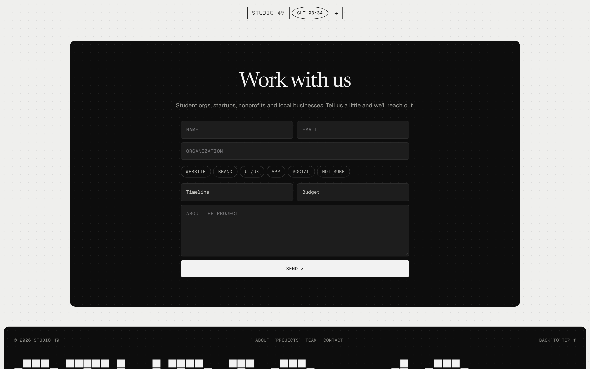

**Studio 49 is a student-run design and development studio, and it needed a
front door.** One screen, one idea: a dot-matrix display that spells the
studio's name and then makes room for the work.

## The landing

A canvas of a few thousand dots, drawn from a hand-built 5×7 pixel font. Words
dissolve dot by dot and re-form, the dots under the cursor glow, and a click
sends a ripple across the panel and moves on to the next word. It stops
drawing whenever it's off screen.

## The menu

The whole navigation is three small pills — the name, a live oval that cycles
the local time, and a plus. The plus wipes a black panel down over the page
and springs the links in one after another. It can be closed mid-animation and
reopened cleanly.

## About

## Projects, coming soon

The studio's first projects were still in progress at launch, so every slot
runs its own little display until there's real work to put in it.

## The team

A plain list. The keyword tags come from the bracket device in the studio's
brand identity, one colour per discipline, and the roster lives in a single
config file so anyone on the team can update it.

## Work with us

## How it's built

Plain HTML, CSS and JavaScript — no framework, no build step. Motion handles
the springs and staggers; everything else is hand-written. Type is set in four
faces with one job each: a dot-matrix face for the name and numbers, a serif
for headlines, a sans for reading and a mono for labels. It deploys to GitHub
Pages on every push.
