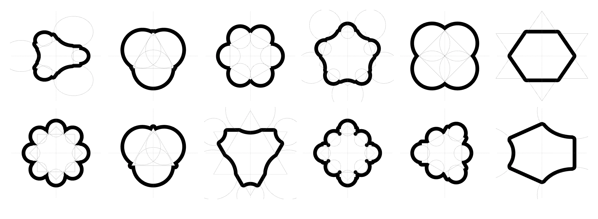
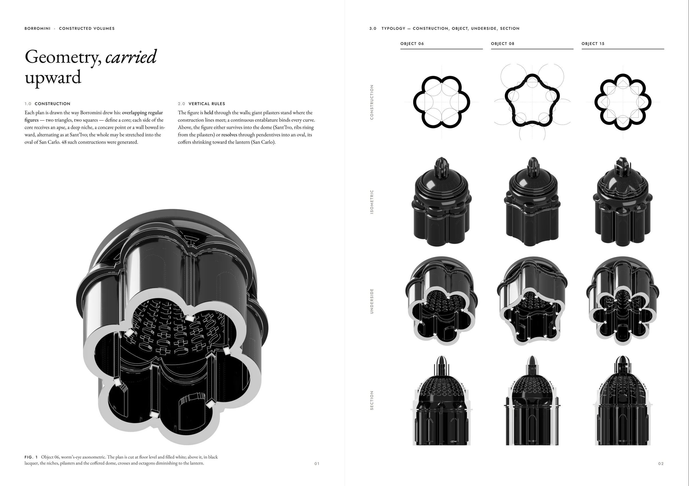
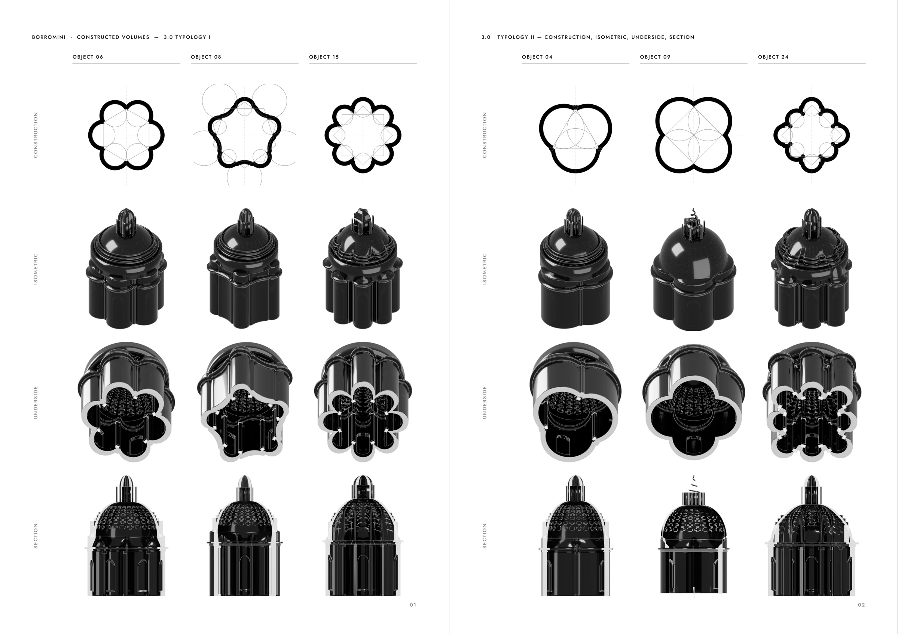

**A plan is not drawn, it is constructed.** Borromini started every plan from
a simple figure, two triangles or two squares, and set out walls, niches,
pilasters and the dome from its lines. Tracciato, Italian for those
setting-out lines, turns that procedure into code: 48 objects generated from
his method, and 24 hybrids from a neural network that crosses Roman plans
with sections. Ongoing research.

[Live site ↗](https://alichaaraoui.github.io/tracciato/)

