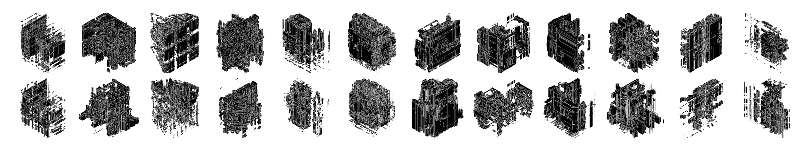
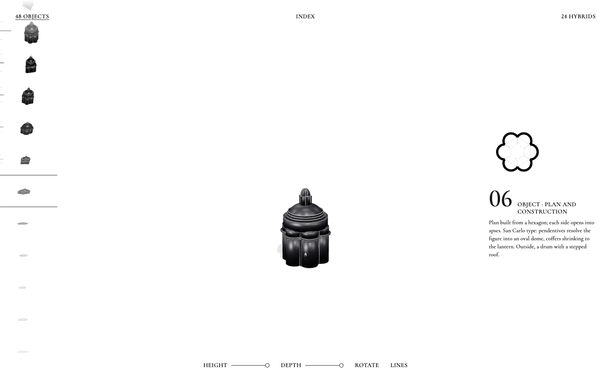

**A plan is not drawn, it is constructed.** Borromini started every plan from
a simple figure, two triangles or two squares, and set out walls, niches,
pilasters and the dome from its lines. Tracciato, Italian for those
setting-out lines, turns that procedure into code: 48 objects generated from
his method, and 24 hybrids from a neural network that crosses Roman plans
with sections. Ongoing research.

[Live site ↗](https://alichaaraoui.github.io/tracciato/)

## 1. Plans

Each plan starts from **one regular figure or two overlapping copies**:
Sant'Ivo's two triangles, two squares, a pentagon, a hexagon. Every side of
the core then gets an **apse, a deep niche, a bulging wall, a concave star
point or a straight wall**; some plans gain corner columns, some are
**stretched into an oval**, as at San Carlo.

## 2. Objects

The plan is carried upward along **720 rays**, so every level keeps the
figure: walls, **pilasters where the construction lines meet**, an
entablature, then a **Sant'Ivo** or **San Carlo** dome and a lantern with its
own smaller figure.

## 3. Hybrids

A **CycleGAN** trained on unpaired Roman plans and sections. Each form is a
plan's footprint intersected with two sections: the network's own
(**translated**) or two real ones from unrelated buildings (**clashed**). An
early run: the network mostly echoed its input.

## 4. The site

All 72 forms in a live viewer: the plan and a generated description beside
each, height and depth cuts, and a view that eases back after you let go.

